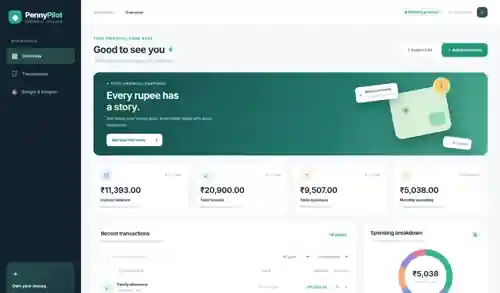
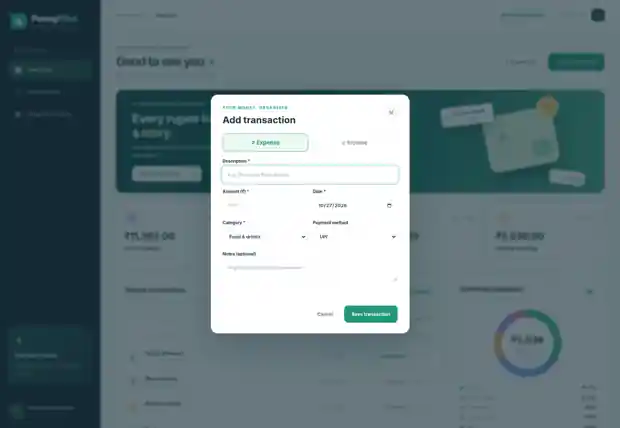

# PennyPilot - Personal Expense Tracker

**AAT-1 | Portfolio-Driven Development | Full Stack Technologies**

PennyPilot is a responsive, client-side financial dashboard built with **HTML5, CSS3, and vanilla JavaScript**. It lets an individual record income and expenses, set a monthly spending budget, analyze spending categories, and export transactions as CSV. It saves the data locally in the same browser using `localStorage` - no server, login, or paid service is required.

> This is an academic frontend project, **not a bank-connected or investment application**. It does not connect to financial accounts, share data with a server, or promise real-time synchronization.

## Features

- Create **income** and **expense** transactions with description, amount, date, category, payment method and optional notes.
- Edit or delete transactions; deletion asks for confirmation.
- Dashboard showing **total income, total expenses, available balance, and current-month expenses**.
- Filter by transaction type and category; search descriptions, categories, methods and notes.
- **Monthly budget** with amount remaining or overspending warning.
- CSS-generated **spending breakdown donut chart** for this month's expense categories.
- CSS-generated **six-month income vs expense chart**.
- **CSV export** of the currently filtered transactions.
- Responsive design with desktop and mobile navigation.
- Browser `localStorage` persistence with example transactions on first launch.

The first launch starts with **16 demonstration transactions**, deliberately made up for demonstration; they are not actual financial records.

## Tech stack

| Technology | Purpose |
| --- | --- |
| HTML5 | Semantic dashboard, forms, dialog, navigation |
| CSS3 | Responsive layout, category breakdown chart, monthly bar graph |
| JavaScript ES2020+ | Transaction CRUD, validation, filtering, statistics, chart data |
| localStorage | Persistent JSON records within one browser profile |
| Python + Playwright | Optional automated browser interaction tests |

## How to run

Option A - easiest:
1. Download and extract the repository files.
2. Open `index.html` in a modern browser (Chrome, Edge or Firefox).
3. Click **Add transaction** to begin recording income and expenses.

Option B - local development server (recommended for consistent browser origin):

```bash
cd personal-expense-tracker
python -m http.server 8000
```

Then open `http://localhost:8000` in your browser. No `npm install` is needed.

## How to use

1. Click **Add transaction** and choose Income or Expense.
2. Enter a title, positive amount, date, category and payment method.
3. Use the pencil icon to edit and the cross icon to delete entries.
4. Use search and two dropdowns to filter transactions.
5. Enter a monthly budget and click **Save**. It is stored separately.
6. Click **Export CSV** to save a copy of visible filtered transactions.

The dashboard uses **INR (₹)**. The record data remains local to the current browser/profile and origin. Clearing browser data, using private mode, switching devices, or opening the files under a different URL can affect access to stored records. CSV export is a one-way backup; import is not implemented.

## Repository structure

```text
personal-expense-tracker/
├── index.html                   # Application structure
├── styles.css                   # Styling and responsive dashboard
├── app.js                       # Transaction CRUD, filter, calculations, export
├── screenshots/
│   ├── dashboard.webp            # Genuine dashboard capture (optimized preview)
│   ├── add-transaction.webp      # Genuine input form capture (optimized preview)
│   └── mobile.webp               # Genuine narrow-screen capture (optimized preview)
├── tests/
│   └── test_app.py              # Playwright UI regression tests
├── README.md
└── .gitignore
```

## Project screenshots

**Dashboard**



**Add transaction form**



**Mobile layout**


## Testing

```bash
python -m pip install playwright
python -m playwright install chromium
python tests/test_app.py
```

Tests cover first load, adding and editing expenses, search and type filters, deletion confirmation, monthly budget updates, CSV download, mobile navigation, and JavaScript runtime errors.

**Environment caveat:** The managed Chromium runtime used to produce these screenshots blocked navigation to localhost. The automated test runner therefore fell back to loading the actual HTML/CSS/JavaScript in a browser page with an *in-memory* localStorage substitute. That fallback exercises UI interactions and stored-data rehydration, but **does not verify real cross-refresh or disk persistence**. Run the app in an ordinary browser and refresh to confirm persistence before marking that test as passed.

## Known limitations / future work

- Single-device/browser data; no user accounts, database or synchronization.
- No automatic transactions pulled from UPI, banks, or cards.
- No receipt uploads, recurring payments, import, or notifications.
- Budget currently covers total monthly expenses rather than each category.
- Demo records start automatically on a first visit. Clearing browser data resets them.

## AAT-1 submission evidence

Attach a screenshot of this repository's root file listing once uploaded to GitHub. Use the authentic screenshots in `screenshots/` for working output evidence. Confirm submission and student details before printing the report.

**Published repository:** `https://github.com/kowshiksn035-spec/Expense-tracker-` (the link becomes valid only after upload).

**Project title:** Personal Expense Tracker (PennyPilot)  
**Course:** Full Stack Technologies  
**Academic year:** 2026-27

**Screenshots:** The three WebP screenshots in this repository are optimized previews of actual browser captures. Full-resolution PNG images are retained in the downloadable project package.
